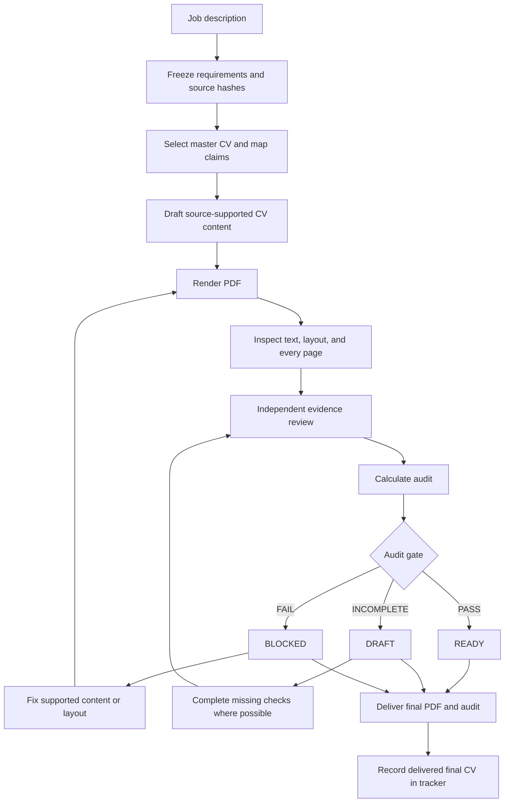

# Create a CV

Use `cv-writer` with a job URL, pasted description, or role handoff from `analyze-job`.
The selected master CV is the source for career claims.

## Review flow

Text fallback: Freeze the requirements, select evidence, draft the CV, render the PDF, and inspect each page.
Obtain independent review and calculate the audit. A pass produces `READY`; incomplete checks produce `DRAFT`; failed checks produce `BLOCKED`.
Any content or layout change requires a new PDF and repeated checks. Record a delivered final PDF even when its audit blocks use.

## Source controls

Freeze job requirements before candidate review. Preserve required and preferred status, alternatives, exact source quotations, and source hashes.
Map each CV claim to a supported source. Preserve historical titles, employers, dates, chronology, and attribution.
The job description can guide relevance. The job description cannot prove that the candidate has a skill or achievement.

## Layout controls

The default is one page. Use two pages when explicitly requested or when distinct, relevant evidence cannot fit one page.
Record the evidence that supports a second page. A high rubric score alone does not justify two pages.

The current rules require at least 98% fill for every actual one-page PDF.
Fill is a layout measure. Fill does not prove readability or accurate claims.
Do not add filler or inflate claims to meet a layout target.

Inspect page count, fonts, text bounds, sections, bullets, page breaks, and every rendered page.
Keep the layout companion tied to the PDF hash. A content or layout edit requires a new render and repeated checks.

## Independent review

Give the reviewer the frozen requirements, source CV, final PDF, extracted text, and rubric.
Exclude previous scores, writer rationale, and positioning preferences.
If independent review is unavailable, record `INDEPENDENT_REVIEW=NOT_RUN`. A same-context second pass is not independent.

## Delivery

| Result | Meaning |
| --- | --- |
| `READY` | The audit gate passed |
| `DRAFT` | The audit gate is incomplete |
| `BLOCKED` | The audit gate failed |

Deliver the final PDF with its audit and material gaps.
The tracker skill records final delivered PDFs, including drafts and blocked CVs. Intermediate renders do not qualify.
A tracker or viewer failure does not change the audit result.

Next: [Track Applications](Track-Applications).

Process references: `cv-writer` instructions, `cv_customization_prompt.md`, `cv_alignment_scoring.md`, and the PDF helpers.
