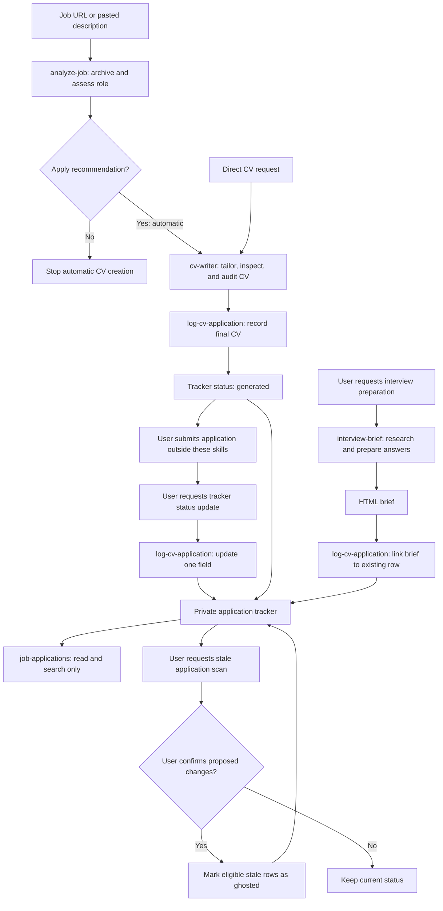

# Job Applications Workflow

This wiki explains a repeatable process for role assessment, curriculum vitae (CV) creation, application records, and interview preparation.
All examples are fictional. The wiki contains no candidate profile, career history, real application record, or internal path.
This wiki is public. Application records and private source documents are separate from this documentation.

## Workflow

Text fallback: Assess a role from a job URL or pasted description. An apply recommendation starts CV creation automatically.
Record the final CV with the status `generated`. The user submits the application separately and requests a status update.
Interview preparation creates an HTML brief and links the brief to an existing application record.
Tracker searches are read-only. Changes from the stale-record scan require confirmation.

## Read the guide

| Page | What the page explains |
| --- | --- |
| [Skills Reference](Skills-Reference) | Each skill's purpose, inputs, outputs, relevance, and handoffs |
| [Sources and Instructions](Sources-and-Instructions) | The role and authority of each source, instruction file, and helper program |
| [Assess a Role](Assess-a-Role) | Job description archive, evidence, role fit, and apply decisions |
| [Create a CV](Create-a-CV) | Requirements, claims, PDF checks, independent review, and audit results |
| [Track Applications](Track-Applications) | New records, status updates, duplicate checks, and receipts |
| [Prepare for Interviews](Prepare-for-Interviews) | Employer research, evidence maps, gaps, and interview answers |
| [Maintain the Tracker](Maintain-the-Tracker) | Searches, field updates, and confirmed stale-record changes |
| [Quality and Privacy](Quality-and-Privacy) | Evidence rules, uncertainty, failure outcomes, and access boundaries |

## Two separate assessments

The role-fit assessment asks whether a role merits an application.
The CV audit checks whether the final CV supports its claims, addresses requirements, and passes document checks.
An apply recommendation does not mean that the CV is ready. A generated CV does not mean that an application was sent.

## Scope

The skills prepare documents and maintain records. Application submission remains a separate user action.
Cover letters are separate user-requested documents governed by the project instructions. The workflow has no dedicated cover-letter skill.

Process references: the five skill definitions and the source contracts described in [Sources and Instructions](Sources-and-Instructions).
