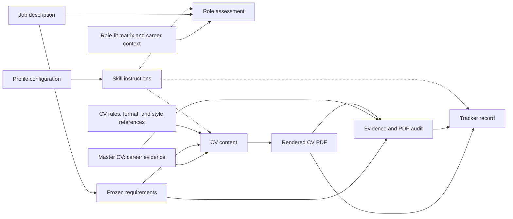

# Sources and Instructions

Each file has one primary role: control the process, supply evidence, store a result, or execute a check.
This page uses basenames and generic labels. The page does not publish private file contents or locations.

## Source relationships

Text fallback: The job description supplies frozen requirements. The selected master CV supplies career evidence.
Role-fit resources support the apply decision. CV rules guide content, format, and review.
The final PDF and audit describe the delivered CV. The tracker records the document and application metadata.
Skill instructions control the steps and handoffs.

## Instruction files

| File | Purpose | Why the file matters |
| --- | --- | --- |
| `AGENTS.md` | Define workspace and project behavior, including cover-letter structure | Set shared conventions without duplicating skill procedures |
| `SKILL.md` for `analyze-job` | Define job intake, archive, research, eligibility, role scoring, and automatic CV handoff | Explain the apply decision and when CV creation starts |
| `SKILL.md` for `cv-writer` | Define requirements, evidence, document checks, review, audit, and delivery | Keep the delivered CV consistent with sources and quality gates |
| `SKILL.md` for `log-cv-application` | Define tracker writes, conflict checks, brief links, updates, and receipts | Give one skill ownership of tracker changes |
| `SKILL.md` for `job-applications` | Define tracker queries and terminal output | Keep lookups read-only |
| `SKILL.md` for `interview-brief` | Define role resolution, research, answers, conversion, and brief handoff | Keep interview preparation tied to the selected role and evidence |
| `cv_customization_prompt.md` | Define claim fidelity, source priority, CV selection, page decisions, and draft rules | Prevent unsupported claims and resolve conflicting style advice |
| `cv_alignment_scoring.md` | Define frozen requirements, evidence classes, independent review, and audit gates | Make CV quality checks repeatable and separate from role fit |
| `CV Format Spec.md` | Define document structure, typography, layout, and emphasis | Give the renderer and reviewer a shared format reference |
| `harvard_guide_distilled.md` | Provide secondary advice on achievement statements, relevance, and structure | Improve presentation within current evidence and page rules |
| `ai_writing_antipatterns_distilled.md` | Identify filler, generic phrases, and repetitive prose patterns | Support specific, direct CV prose without a claim about authorship |

Source fidelity and objective review take priority over conflicting style advice in the CV workflow.
The current CV rules control page decisions. Older style advice does not override those rules.

## Private configuration and evidence

| File or source | Purpose | Why the file matters |
| --- | --- | --- |
| `profile.md` in each applicable skill | Supply identity, private resource locations, variants, and selection preferences | Connect each skill to its configured inputs; values stay private |
| `role_alignment_scoring_matrix.md` | Define role-fit criteria, weights, thresholds, flags, and CV selection rules | Make role decisions consistent; skill-specific evidence policies still apply |
| `career_analysis.md` | Supply candidate context, priorities, and target-role tiers | Support fit interpretation and interview preparation without new career claims |
| `prod_cv_content.json` | Hold the product-oriented master CV evidence | Supply supported facts for the `Prod` variant |
| `proj_cv_content.json` | Hold the project-oriented master CV evidence | Supply supported facts for the `Proj` variant |
| Employer posting or pasted description | Supply role responsibilities, requirements, and explicit constraints | Establish what the employer asks for |
| Cited employer and industry research | Supply current context and authoritative role corrections where permitted | Separate external facts from candidate evidence |
| Legacy score CSV | Supply prior role scores to the interview skill when a match exists | Avoid an unnecessary score calculation; does not replace the Markdown write tracker |

The master CV supplies career facts. The profile supplies configuration and identity.
The job description supplies requirements. Research supplies context. These sources have different authority.
Private career context does not authorize invented achievements or result metrics.

## Records created by the workflow

| File or record | Purpose | Why the record matters |
| --- | --- | --- |
| `job_description.md` | Archive a readable role description with its source when available | Keep the role context available for CV and interview work |
| `jd.txt` | Preserve the job text for the CV audit | Bind requirement extraction to the original review input |
| `requirements.json` | Store requirement IDs, quotes, required or preferred status, alternatives, and ambiguity | Stop later candidate review from silently changing requirements |
| `cv_content.json` | Hold the selected content for the renderer | Connect supported source claims with the final document |
| Final PDF | Present the delivered CV | Provide the exact text and pages that the audit checks |
| PDF layout companion | Store measured layout units, page breaks, and the PDF hash | Detect a mismatch between layout evidence and the delivered PDF |
| Extracted PDF text | Preserve final text with page boundaries | Support evidence quotes and page-specific checks |
| `review.json` | Store claims, evidence mappings, gaps, check evidence, and review independence | Give the audit calculator structured review evidence |
| `audit.json` | Store calculated checks, coverage, gate result, and score or score interval | Explain readiness and bind the audit to the final files |
| `cv-log-input.json` | Pass the final PDF metadata and persistent generation identifier to the tracker skill | Support reliable creation and retries |
| `cv-log-receipt.json` | Record the checked outcome of a CV tracker operation | Help retries without replacing a fresh tracker read |
| Interview brief Markdown | Structure research, role alignment, answers, and the source description before conversion | Supply the converter's fixed sections; the successful workflow removes this temporary source |
| Interview brief HTML | Present the completed brief with its tabs and score panel | Give the user a self-contained preparation document |
| `interview-brief-log-input.json` | Pass the exact role identifier and completed brief reference | Link the brief to the correct tracker row |
| `interview-brief-log-receipt.json` | Record the checked outcome of the brief link operation | Distinguish a completed brief from a successful tracker update |
| `Job Application Tracker.md` | Store application metadata, document references, status, and optional outcome fields | Keep the primary application record in one Markdown table |

## Executable helpers

| Helper | Purpose | Why the helper matters |
| --- | --- | --- |
| `create_role_dir.py` | Create a unique role identifier for an archived job description | Prevent unrelated analysis runs from sharing a role record |
| `cv_generator.mjs` | Render CV content as a PDF and emit layout measurements | Produce a repeatable document within its page cap |
| `cv_generator_template.ps1` | Provide a Windows or WSL fallback for supported Node renderer failures | Preserve the same document requirements when the primary renderer fails |
| `cv_pdf_checks.py` | Inspect text, fonts, bounds, sections, emphasis, and pagination | Supply document checks; visual review remains a separate step |
| `cv_audit.mjs` | Validate review inputs and compute checks, coverage, and the audit gate | Separate deterministic calculations from evidence judgments |
| `search_tracker.py` | Read and search the Markdown tracker | Support lookups without writes |
| `entry.py` in the tracker skill | Validate, reconcile, write, read back, and locally commit tracker changes | Keep tracker operations consistent across handoffs and user requests |
| `md_to_html.py` | Convert the interview Markdown into a self-contained HTML brief | Render the fixed brief structure consistently |

See [Skills Reference](Skills-Reference) for triggers and handoffs.

Process references: the current skill definitions and the schemas or interfaces declared by the named helpers.
