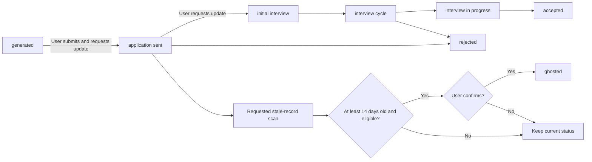

# Track Applications

Use `log-cv-application` to record final CVs and link interview briefs.
The primary application record is a Markdown table. A new CV record starts with the status `generated`.

## Record a CV

1. Pass the final PDF metadata and persistent generation identifier to the tracker skill.
2. Validate the PDF, source details, CV reference, and optional role identifier.
3. Check the tracker for an existing record or conflict.
4. Write the row only when the record is safe to create.
5. Read the tracker again to check the result.
6. Save the receipt and report the local Git commit outcome where applicable.

A matching retry returns `already_logged` and preserves a manually changed status.
After an uncertain write, retry once with the same input. Do not delete or repair conflicting records automatically.
A receipt is a retry hint. The current tracker remains the source for the current record.

## Status flow

Text fallback: A generated CV can become an application sent after the user submits the application and requests an update.
Later user updates can record interviews, acceptance, or rejection. An eligible stale record can become ghosted only after confirmation.
The diagram shows a typical sequence. The helper validates status values but does not enforce every arrow as a required transition.

Accepted status values are `generated`, `application sent`, `initial interview`, `interview cycle`, `interview in progress`, `rejected`, `ghosted`, and `accepted`.

## Tracker fields

| Field | Purpose |
| --- | --- |
| CV name | Identify the final PDF |
| Status | Record the current application stage |
| Generation date | Record when the final CV was created |
| Source type and Source | Distinguish URL input from text input and preserve the supplied posting URL |
| Reference | Record the selected master variant as `Prod` or `Proj` |
| Company name and Role title | Preserve employer and role details from the source |
| Directory | Store the exact role identifier, or remain blank for a standalone CV |
| Interview Brief | Link the completed HTML brief |
| Result, Last updated, and Notes | Optional outcome, recency, and context fields |

The helper updates `Last updated` when that column exists.
The `Status` and `Result` columns are separate. Do not assume that one column automatically mirrors the other.

## Link an interview brief

Pass the exact role identifier and completed HTML brief to the tracker skill.
One matching row receives the brief link. No match returns `not_found`; several matching rows return `conflict`.
The completed brief remains valid if the tracker update fails.

Process references: `log-cv-application` instructions and `entry.py`.
